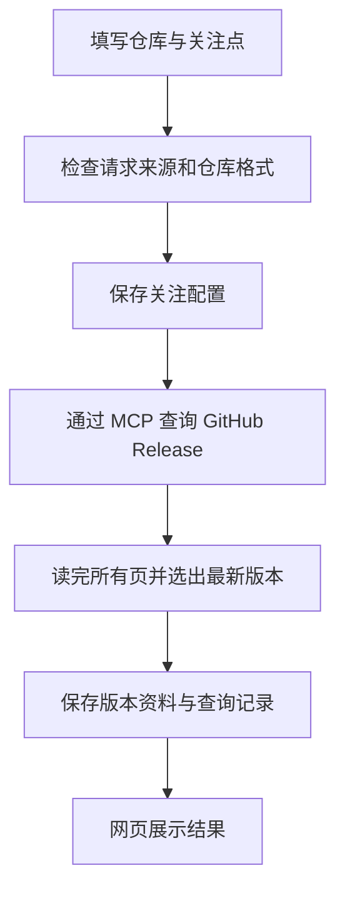

# 01 阶段数据流：从填写仓库到查看版本

更新日期：2026-10-17。依据当前代码整理，包含本次审查后的三项修正。

当前应用能完成：**填写仓库和关注点 → 查询 GitHub 版本 → 保存资料 → 网页查看**。这是 V1 的第一阶段，目前展示的是版本原资料，调查和报告生成由后续阶段实现。

**一、先认识三个角色**

- **网页和 Python 程序**：接收输入，决定查什么、保存什么、展示什么。
- **GitHub MCP**：提供查询工具。Python 通过 MCP 客户端，在 Docker 中启动 GitHub 官方服务端，由它请求 GitHub。MCP 是调用工具的通道，当前没有 AI 模型参与。
- **SQLite**：本机磁盘上的数据库文件，保存退出程序后仍要保留的数据。

Release 是仓库作者在 GitHub 上发布的版本资料，通常包含版本标签、发布说明、发布时间和来源链接。

**二、点击“保存并查询”后发生什么**



以填写 `psf/requests`、关注点“关注兼容性变化”为例：

1. **检查输入。** 网页要求仓库使用 `owner/repo` 格式，例子中 owner 是 `psf`，repo 是 `requests`。保存接口还检查请求是否来自本应用：优先检查 `Origin`，缺少时检查 `Referer`，也就是浏览器提供的来源信息。协议、主机和端口必须匹配；校验失败就停止，不保存、不查询。
2. **先保存配置。** 将仓库和关注点写入数据库。因此，即使后面查询失败，关注配置仍然存在。关注点目前只保存，不参与版本筛选。
3. **发起真实查询。** Python 调用 MCP 的 `list_releases` 工具，传入仓库和页码。GitHub 返回 Release 列表，每页最多 100 条；返回不足 100 条时才结束分页。
4. **选出最新版本。** 正式版和预发布版一起比较，排除草稿，按 `published_at`（发布时间）选最新；时间相同则按 GitHub Release ID 确定顺序。读完所有页后，才确认答案，不直接采用第一页第一条，也不比较版本号大小。
5. **保存并展示。** 有版本时，保存该版本及关联查询记录；没有版本时，只保存“暂无已发布版本”的查询记录。成功后跳转首页，从数据库读取并展示。

分页是为了找到最新版本，当前一次查询只保存选中的一个版本。每页都有自己的调用记录，中间页成功不代表整次查询成功。

**三、数据库里保存了什么**

| 表 | 保存内容 | 用途 |
| --- | --- | --- |
| `watch_configs` | 仓库、关注点 | 记住用户关注什么 |
| `releases` | 版本标签、类型、发布说明、来源链接、发布时间等 | 之后可以再次查看原资料 |
| `tool_calls` | 工具参数、调用时间、结果摘要或错误、查询结论 | 知道查询是否成功，以及失败在哪一步 |

配置、版本和调用记录通过仓库名对应；成功调用还通过 `release_id` 关联本地版本记录。这个本地编号与 GitHub 的 Release ID 是两个不同编号。

重复查询同一仓库的同一 Release，会新增调用记录，复用已有版本记录。当前只更新正式版／预发布版类型，其他资料保留首次保存内容。重复提交配置也会新增配置行，页面按仓库合并展示版本资料。

“保存”来自代码实际写入 SQLite 并提交。返回一个 Python 对象本身不会保存数据，程序重启后也不会保留内存中的变量。

**四、查询失败时怎么处理**

查询函数通过 `QueryResult` 把结论交给网页，可以把它理解成一张“结果单”：

| 结论 | 含义 |
| --- | --- |
| `found` | 全部查完，找到版本，相关保存完成 |
| `empty` | 全部查完，没有非草稿版本 |
| `inaccessible` | 有证据说明无法访问目标，但不能确定是不存在还是权限、凭据问题 |
| `failed` | 超时、限流、返回格式异常等，无法确认当前版本 |

**没有查到结果，不等于确认没有版本。** 例如第二页超时，即使第一页拿到了版本，也不能将它保存为本次确认的最新版本。

所有分页共用 60 秒查询等待期限，不自动重试。连接清理和写库还可能花时间，因此网页请求不保证在 60 秒内结束。

发生错误后，程序尝试记录原因，以及出错环节：调用 MCP、解析资料或保存结果。错误记录会遮盖已识别的凭据，网页不展示原始异常。未知错误保留为未知，不凭一个“404”就断言仓库没有版本。

保存是分步完成的：配置可以保存成功而查询失败，版本也可能保存成功而调用记录失败。已经保存的数据会保留，页面说明本次操作未完整成功。

**五、刷新与重新查询有什么区别**

```text
点击“保存并查询”：检查请求 → 写配置 → 请求 GitHub → 保存结果 → 展示
刷新或重启后打开：首页读取 SQLite → 展示已保存内容
```

刷新不会调用 MCP，也不会检查 GitHub 是否刚发布了新版本。首页的“最近一次已保存的查询结论”表示数据库最后记录的结果；如果还有更新的未完成调用，页面会提示结论未知。

下面是一个用于理解的例子：

| 操作 | 页面应该表达什么 |
| --- | --- |
| 昨天查到 v1 | 展示成功结论和 v1 资料 |
| 今天查询超时，失败记录保存成功 | 展示今天超时，并说明 v1 是历史资料 |
| 此后刷新或重启 | 从数据库读出相同的超时记录和旧资料 |
| 今天查询失败，连失败记录也没能保存 | 当前错误页显示本次失败，不把昨天的成功当作本次结果 |
| 未保存失败记录后再刷新 | 只能显示此前已保存的结论，无法恢复未保存的失败 |

版本卡片上的两个时间也不同：**GitHub 发布时间**来自发布者；**资料取得时间**来自关联成功调用的开始时间，不是精确的下载完成时间。没有可靠关联时显示“未知”。

**六、本次修正了什么**

| 修正 | 对数据流的影响 |
| --- | --- |
| 提交前增加来源检查 | 不符合来源要求的请求返回 403，在写库和 MCP 查询前停止 |
| 明确当前失败与历史结论 | 未保存的失败用于当前响应；刷新展示“最近一次已保存的查询结论” |
| 合并数据库备份代码 | 两种迁移共用 `backup_database()`，仍然先备份再迁移，不覆盖已有备份 |

最近一次代码验证：**69 项 unittest 全部通过**，包含同源校验、失败记录无法保存、分页查询和重启读取等行为测试。这些自动化测试使用模拟 MCP 与临时数据库。

此前的真实 MCP、浏览器和重启验证见[01 最终验收记录](../../.scratch/release-query-failures/final-acceptance.md)。该记录属于修正前的验收，本次整理文档没有重新发起真实查询；证据文件位于被 Git 忽略的 `.scratch` 中。

阅读代码时，按下面顺序看即可：

| 阅读顺序 | 代码入口 | 重点 |
| --- | --- | --- |
| 1 | [web.py](../../src/diff_x_hunter/web.py) 的 `add_watch_config()` | 输入如何被接收和检查 |
| 2 | [github_mcp.py](../../src/diff_x_hunter/github_mcp.py) 的 `query_release()` | 如何查询、选版本、处理失败 |
| 3 | [storage.py](../../src/diff_x_hunter/storage.py) 的 `save_*()` | 数据如何写入磁盘 |
| 4 | [web.py](../../src/diff_x_hunter/web.py) 的 `index()`、`render_page()` | 如何读取记录并展示 |

当前查询由用户手动提交触发，自动追踪、Agent 调查与报告生成仍属于后续任务。01 的用户个人数据流讲解练习也仍需实际完成。
