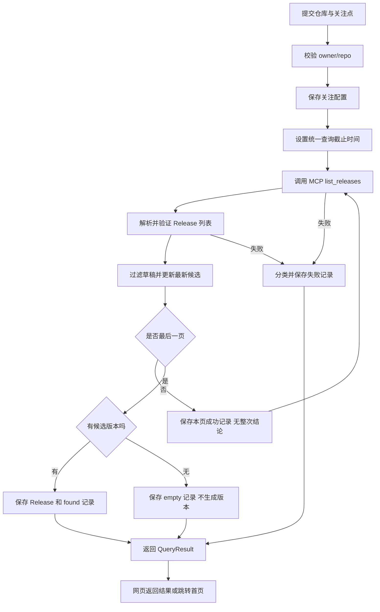
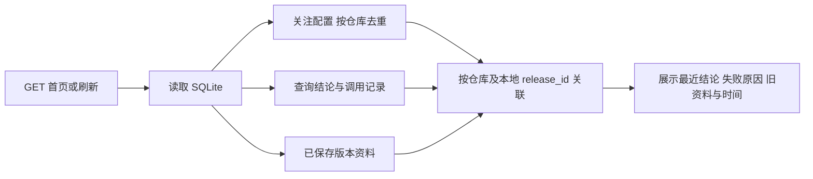

**01 Diff 报告：从保存配置，到可靠地查询、保存和展示版本**

日期：2026-10-16。依据当前源码、Git HEAD `e29dfb3` 和已完成的验收记录编写。

这次工作的结果是：应用能查询真实 GitHub Release；查询失败时，既不会编造“没有版本”的结论，也不会拿旧资料冒充本次成功。结论、原因和资料都能保存，刷新或重启后仍可辨认。

**先说明比较基准**

这里有两个不同的“修改前”，需要分开看：

| 比较基准 | 修改前 | 现在 |
| --- | --- | --- |
| Git HEAD `e29dfb3` | 网页保存关注配置并列出配置 | 接通真实 MCP、Release 选择、SQLite 保存、结果展示及故障处理 |
| 本轮 9.1–9.3 开始时的工作区 | 已能分页查询、保存版本和调用记录；返回字典或 None，异常抛出 | 返回明确查询结论；保存失败分类；页面依据持久化记录展示状态与旧资料时间 |

本轮开始前已经实现了“空列表与异常分开”和“分页失败不保存部分候选”。本轮是在此基础上补齐明确分类、持久化与展示，不能说原程序把所有异常都当成了无版本。

工作区还有此前累积的未提交修改，`github_mcp.py`、`migrate.py` 等文件目前属于 Git 未跟踪文件。普通 `git diff` 不包含这些文件，所以本报告是基于源码的行为差异报告，不把整份工作区行数统计当成本轮净增量。

**一、先理解程序在保存什么**

可以把系统理解成三本记录簿：

| 记录簿 | 数据位置 | 回答的问题 |
| --- | --- | --- |
| 关注配置 | `watch_configs` | 用户关注哪个仓库、关注什么？ |
| 查询记录 | `tool_calls` | 哪次调用发生了什么？整次查询得出了什么结论？ |
| 版本资料 | `releases` | 已经保存过哪些真实版本、说明与来源？ |

例如：昨天查到 v1.0，今天查询超时。正确状态是“配置仍在、今天查询失败、昨天资料仍在”。这三件事可以同时成立，不需要互相覆盖。

配置保存成功不证明查询成功；数据库中有版本不证明这次查询成功；这次没拿到版本也不证明仓库没有版本。

**二、主要修改及其职责**

| 文件 | 本轮重点修改 | 为什么放在这里 |
| --- | --- | --- |
| [github_mcp.py](../../src/diff_x_hunter/github_mcp.py) | `QueryResult`、失败分类、等待期限、按阶段处理异常、脱敏并保存结论 | 这里知道调用是否成功、响应是否有效、分页是否完整，具备判断证据 |
| [storage.py](../../src/diff_x_hunter/storage.py) | `save_tool_call()` 增加结果字段；新增 `load_query_results()` | 存储层负责忠实写入和读取，不通过错误文案猜业务结论 |
| [migrate.py](../../src/diff_x_hunter/migrate.py) | 新增带备份的查询状态迁移 | 给旧库加字段，同时保护已经保存的资料 |
| [web.py](../../src/diff_x_hunter/web.py) | 按结果分支；从数据库展示最新结论、原因、旧资料时间；移除 URL 伪成功 | 页面把已知事实翻译成可理解的文字，不重新推断 GitHub 状态 |
| [查询契约测试](../../tests/test_query_outcomes.py) | 分类、超时、保留资料、持久化、脱敏等 | 验证查询过程的可观察行为 |
| [网页测试](../../tests/test_web.py) | 提交、刷新、重启、失败提示、时间和 URL 参数 | 验证用户实际看到的结果 |
| [迁移测试](../../tests/test_migrate.py) | 备份、重复运行、旧资料不变、失败回滚 | 验证升级数据库不会破坏原资料 |

MCP 负责把本地调用送到 GitHub；GitHub 提供数据；本项目的 Python 负责解释结果。当前没有 LLM 参与这些判断，也没有生成调查报告。

**三、返回值为什么改成 QueryResult**

以前调用者接到的是“一个版本字典”或 `None`，遇到故障则捕获异常。现在预期的外部查询结果使用统一对象表达：

```python
@dataclass(frozen=True)
class QueryResult:
    outcome: Literal["found", "empty", "inaccessible", "failed"]
    release: dict | None = None
    reason_code: str | None = None
```

这三个字段分别回答：结论是什么、有哪些版本资料、失败原因是什么。它是本项目定义的“查询结果单”，不是 GitHub MCP 的返回协议。

| outcome | 成立条件 | 不能据此推断什么 |
| --- | --- | --- |
| `found` | 所有页有效且查完，有非草稿版本，所需保存完成 | 不代表已生成调查报告，也不代表已经检查你的项目兼容性 |
| `empty` | 所有页有效且查完，没有非草稿版本 | 不代表历史保存资料应被删除 |
| `inaccessible` | 有可靠证据说明本次无法访问目标 | 不确定究竟是仓库不存在、权限还是凭据问题 |
| `failed` | 超时、限流、无效响应或其他无法确认的错误 | 不代表没有 Release |

注意两个容易混淆的地方：

- `QueryResult.release is None` 可以出现在 empty、inaccessible、failed 中，不能仅凭它判断查询结论。
- `return QueryResult(...)` 只是把结果交给调用者，并不会自动保存。保存来自显式调用 `save_tool_call()` 和 `save_release()`。

**四、异常处理为什么要区分阶段**

程序用 `stage` 标记正在做哪件事：

| 阶段 | 操作 | 典型结果 |
| --- | --- | --- |
| `query` | 等待 MCP 返回、检查工具错误 | timeout、access_unavailable、rate_limited、unknown |
| `parse` | 解析 JSON、检查列表和字段、选择候选版本 | invalid_response，或继续处理 |
| `save` | 保存 Release 和调用记录 | 成功，或 save_failed |

同样的异常类型，发生在不同位置可能代表不同问题。例如解析阶段的 `ValueError` 可以说明响应无效；保存阶段的 `ValueError` 不能因此被解释成 GitHub 返回无效。

失败后的控制流是：

```text
捕获异常
  → 根据发生阶段与证据分类
  → 对错误文本脱敏
  → 尝试保存失败记录
      ├─ 记录也保存失败：保留原始异常，附注“失败记录未能保存”，继续抛出
      └─ 记录保存成功
          ├─ 原异常发生在 save：继续抛出，由网页报告保存失败
          └─ 原异常发生在外部调用/解析：返回明确的失败结果
```

这里保留 `raise` 是有意的：数据库无法完成保存，不应返回一个让调用者误以为“结果已经记录”的普通完成结果。

分类遵循证据。只有工具或 MCP 错误符合已核对的官方格式、URL 对应本次查询目标，才解释其中的访问状态。403 还需区分明确的权限问题与限流。裸文本“404”、其他仓库的 URL、陌生错误格式都会回落为 `failed/unknown`。

脱敏会遮盖配置中的 PAT、常见 GitHub token 和 Bearer/token 值；页面不直接输出原始异常。它不是对任意未知秘密格式的全面识别器。

**五、一次提交的数据流**



这张图描述外部调用与解析的主要路径；保存本身失败时按上一节的异常传播规则处理。输入校验失败或配置保存失败都会提前停止，不调用 MCP。

几个设计决策与数据流直接相关：

1. 关注点只保存在配置中，不作为 Release 查询参数。当前请求 GitHub 使用 owner、repo、page 和 perPage。
2. 每页最多 100 条；不足 100 条才视为最后一页。刚好 100 条时还要继续请求，不能猜后面没有数据。
3. 正式版与预发布版都接受，过滤草稿；按带时区的 `published_at` 选择最新，同时间戳用 Release ID 稳定排序，不比较版本标签大小。
4. 所有页共用一个 60 秒截止时间，不为每页重新发放 60 秒。超时取消等待，连接清理和同步保存可能还需要时间，它不是整个 HTTP 请求的硬性 60 秒上限。
5. 全部页确认成功后才保存最新候选。第一页面的候选只是暂存于内存的可能答案。

**六、单页成功为什么不等于整次成功**

`tool_calls` 同时保存每页调用记录和最后的完整结论，因此需要两个不同字段：

| 字段 | 粒度 | 示例 |
| --- | --- | --- |
| `status` | 本页调用及处理记录 | success / error |
| `query_outcome` | 整次查询结论，仅末页或失败页填写 | found / empty / inaccessible / failed |

例如第一页面拿到 v2，第二页超时：

| 页码 | status | query_outcome | reason_code | release_id |
| --- | --- | --- | --- | --- |
| 1 | success | NULL | NULL | NULL |
| 2 | error | failed | timeout | NULL |

第 1 页确实成功，不应抹掉它的记录；但没有完整读完列表，不能把 v2 保存成“本次确认的最新版本”。

这也是为什么不能通过“最后一条 success”来判断仓库最近查询成功。新读取函数只返回有完整结论的记录；页面还检查是否存在更晚的未完成调用，避免将旧成功继续当作最新结论。

**七、数据表如何关联，如何持久化**

```text
watch_configs.repository ── 仓库名 ── releases.repository
             │
             └── 对应 tool_calls.arguments_json 中的 owner/repo

tool_calls.release_id ── 本地外键 ── releases.id
```

这里没有新建独立查询表，也没有给所有数据强加同一个状态。复用现有 `tool_calls`，新增三个可空字段：

| 新字段 | 用途 |
| --- | --- |
| `query_outcome` | 保存整次查询结论 |
| `reason_code` | 保存 timeout、unknown 等可解释原因 |
| `failure_stage` | 保存 query、parse 或 save |

`releases.id` 是本地数据库编号，`github_release_id` 是 GitHub 的版本编号，两者不能混用。页面从调用记录跳转到版本卡片，使用的是本地 `release_id → id` 关联。

仓库名按小写匹配；同一仓库可保存多条关注配置，资料展示按仓库去重。同一仓库与 GitHub Release ID 用于复用版本记录，重复查询会新增调用记录，但不会重复创建同一个版本。已有实现仅更新预发布标记，其他版本资料保留首次内容。

迁移通过 `--query-outcomes` 执行，先创建不可覆盖的备份，再在事务中添加字段；中途失败回滚，重复执行无变更。旧记录新增字段保持 NULL，不能从旧文案猜测分类。原来的八列 `load_tool_calls()` 接口保留，新函数 `load_query_results(repository)` 用于读取明确结论。

持久化依靠 SQLite 写入并提交，不依靠 Python 变量。进程退出时 `QueryResult` 对象消失，但记录仍在磁盘，所以新进程还能读取。

这些写入不是一个跨网络大事务。配置可以先保存成功，后续查询失败；Release 也可能保存成功，但调用记录写入失败。程序保留已经真实保存的数据，报告本次操作未完整成功，不做虚假的整体回滚承诺。

**八、刷新页面的数据流与提交不同**



这条读取路径不调用 MCP。它回答的是“数据库最后记录了什么”，并不承诺页面刷新时 GitHub 仍然处于相同状态。

页面的关键变化可以表示为行为差异：

```diff
- 用 URL 中的 success=true / empty=true 控制成功提示
+ 用数据库中该仓库最近的完整查询结论控制提示

- 显示版本与 GitHub 发布时间，失败使用笼统文案
+ 独立显示最近查询结果、失败原因和环节
+ 保留已有版本，补充资料取得时间及历史资料说明

- query_release 返回字典或 None，网页检查 release is None
+ query_release 返回 QueryResult，网页检查 result.outcome
```

`load_query_results()` 按记录 ID 递增返回，因此最后一条表示最近保存的明确结论，不是根据 GitHub 发布时间选择查询记录。若该仓库还有更新的未完成调用，页面显示结论未知，不沿用旧成功。

页面上的两个时间也要分清：

| 时间 | 来源 | 含义 |
| --- | --- | --- |
| GitHub 发布时间 | Release 的 `published_at` | 作者何时发布版本 |
| 资料取得时间 | 最早关联成功调用的 `called_at` | 用已有记录表示取得这份资料的时间依据 |

`called_at` 实际是该页调用开始时间，不是精确的下载完成时间。界面注明关联成功调用与 UTC；没有可靠关联时显示“未知”，不会拿发布时间代替。

**九、用一条时间线检查自己的理解**

下面是虚构示例，用于解释逻辑，不是额外的真实验收数据。

| 时刻 | 操作与结果 | 数据变化 | 页面应表达 |
| --- | --- | --- | --- |
| 第一天 | 完整查到 v1 | 保存配置、版本和 found 调用记录 | 查到版本，显示资料与取得时间 |
| 第二天 | 再查询超时 | 新增配置与 failed/timeout 记录，原版本不变 | 今天超时，v1 是此前保存资料 |
| 随后 | 刷新页面 | 不写数据，不调用 MCP | 仍显示同一次超时和旧资料 |
| 随后 | 重启应用 | 内存重建，读取相同 SQLite | 同上 |
| 第三天 | 完整查询为空 | 新增 empty 记录，仍不删除 v1 | 本次确认暂无版本，历史资料仍在 |

“结果为空”与“无法获得结果”是不同事实；“历史上拿到过”与“这次确认了”也是不同事实。这两组区别是本次设计的核心。

**十、验证证据与当前边界**

已完成的验证记录来自前一轮交付，本轮只整理报告，没有重新发起网络查询或修改业务代码。

- 66 项 unittest 全部通过，覆盖分页、分类、等待期限、持久化、脱敏、迁移、网页提示与跨进程读取。
- 真实 MCP：正式版查询、无 Release、目标不可访问均已验证。
- 真实成功之后注入受控超时，确认旧资料保留。该故障是模拟，不冒充真实网络超时。
- Chrome 实际提交得到 `deepseek-ai/deepseek-harness` 的预发布版 `dsh-v0.2.1-alpha.4`。
- 服务停止后以新进程重启，浏览器刷新；数据和数据库 SHA-256 一致，没有额外 MCP 调用。

可检查 [最终验收记录](../../.scratch/release-query-failures/final-acceptance.md) 和 [持久化记录](../../.scratch/release-query-failures/persistence-completed.md)。这些证据位于被 Git 忽略的 `.scratch`，需要分享时应单独保留。

当前仍是本机手动“保存并查询”的应用：没有自动重试、后台定时检查、Agent 调查或调查报告。错误格式变化会使访问分类退回 unknown。旧历史记录不推断分类；旧资料不自动刷新成 GitHub 后续编辑的全文。当前没有独立查询批次 ID，页面以同仓库的记录顺序判断最近状态，并未提供并发查询批次隔离。

01 的七项技术验收已完成；用户个人数据流讲解练习未由代理代签，02 及后续能力未开始。

阅读代码时，建议先沿 `web.add_watch_config → github_mcp.query_release → storage.save_*` 看一次写入，再沿 `web.index → render_page → storage.load_*` 看一次读取。最后回看 `classify_failure`：它解释的是“在什么环节，根据哪些证据，我们究竟能确定多少”。
